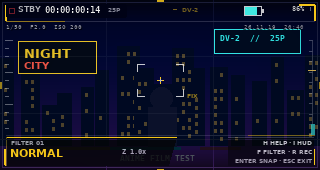
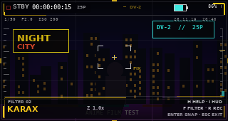
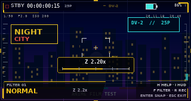

# EDGECAM

A DV-viewfinder camera for the **M5Stack CardputerZero** (Raspberry Pi CM0, Debian 13, 320×170 SPI LCD, IMX219).
It draws straight to `/dev/fb0` and turns the handheld into a tiny viewfinder camera: cool/film grades, smooth digital zoom, freeze-frame snapshots and filtered video.




## Features

| | |
| --- | --- |
| Viewfinder | 320×170 RGB565, ~30 fps HUD on top of a 960×540 preview |
| `01 NORMAL` | cool grade: blue/teal highlights, cold shadows, clean contrast |
| `02 KARAX` | warm film grade with grain, vignette and halation (stills) |
| Zoom | 1.0–3.0× digital, eased; hold `9`/`0` to keep zooming |
| Snapshots | 1640×1232 JPEG, cropped to the active zoom; shutter freezes the current frame instantly (no progress bar) |
| Video | `R` records the filtered viewfinder to 320×170 @20 fps H.264 MP4 |
| HUD | REC/timecode, battery, live exposure, zoom bar, scanline; `I` hides everything |
| Languages | Chinese / English help via `L`, remembered across launches |



### Keys

| Key | Action |
| --- | --- |
| `ENTER` / `SPACE` | snapshot |
| `R` | start / stop recording |
| `F` | NORMAL / KARAX |
| `9` / `0` | zoom out / in (hold = continuous) |
| `I` | show / hide HUD |
| `H` / `TAB` | help |
| `L` | 中文 / English |
| `ESC` | quit |

Photos: `~/Pictures/Camera/EDG_*.jpg` · Videos: `~/Videos/EDG_*.mp4`

## Install

### Debian package

```sh
sudo apt install ./edgecam_1.0.0_all.deb
systemctl --user restart APPLaunch
```

The launcher entry **EDGECAM** appears in APPLaunch.

### From GitHub (public repo)

```sh
curl -fsSL https://raw.githubusercontent.com/YOUR_GITHUB_LOGIN/edgecam/main/get.sh | sh
```

`get.sh` downloads the repo, builds the `.deb` and installs it. Change `REPO` in `get.sh` after forking.

### Build

```sh
sh build_deb.sh          # needs dpkg-deb
sudo apt install ./dist/edgecam_1.0.0_all.deb
```

Package layout:

```
/usr/share/APPLaunch/bin/edgecam                     launcher script
/usr/share/APPLaunch/share/edgecam/edgecam.py        application
/usr/share/APPLaunch/applications/edgecam.desktop    APPLaunch entry (Sysplause=true)
/usr/share/APPLaunch/share/images/edgecam.png        icon
```

Dependencies: `python3 python3-numpy python3-pil python3-evdev python3-picamera2 ffmpeg`.

## CardputerZero AppStore

`app-builder.json` follows the official [AppBuilder schema](https://github.com/CardputerZero/AppBuilder/blob/main/docs/APP_BUILDER_JSON.md)
(`Media` / `Creative & Office`, 320×170 screenshots, camera permission only).

Before publishing, replace the placeholders:

- `store.author.github`, `store.author.display_name`
- `store.source_repo`
- `store.share_code` (4 chars, must be unique in the store)
- `get.sh`'s `REPO` value

Then publish with the official CLI:

```sh
git clone https://github.com/CardputerZero/AppBuilder
cd AppBuilder
./czdev login
./czdev publish --deb /path/to/edgecam_1.0.0_all.deb
```

See [`store/SUBMIT.md`](store/SUBMIT.md) for the full checklist. A `.deb` alone is not enough for the AppStore: listings come from the `packages` registry, and the first release needs a short real-device video in the PR.

## How it works

- **Display** — PIL renders the frame, the RGBA buffer is packed to RGB565 through a `uint32` view and written to a mmap of `/dev/fb0`.
- **Camera** — Picamera2 / libcamera IMX219; 960×540 RGB preview (cropped to 960×510) is area-downscaled to 320×170. The ISP delivers BGR, so channels are swapped and the frame rotated 180° (the module is mounted upside down).
- **Zoom** — crop around the centre before downscaling: at 3.0× the crop is exactly 320×170, so there is no upscaling step and no digital-zoom jaggies. The HUD zoom bar follows an exponential ease.
- **Grades** — per-channel 256-entry LUTs (`Image.point`), vignette multiply, film grain/offset in stills. OpenCV is deliberately not used: importing it costs ~13 s on this CM0.
- **Snapshots** — the shutter freezes the current frame immediately, then the camera switches to 1640×1232, the still is graded, saved and shown in place; the UI never displays a progress bar.
- **Video** — filtered frames are rate-limited to 20 fps and piped to `ffmpeg` (libx264 ultrafast) by a writer thread, so encoding does not block the viewfinder.

Tested at 30 fps (NORMAL) / 27 fps (KARAX) on a CM0.

## Known limits

- IMX219 is a **fixed-focus** lens (~1 m). The `FIX` label is intentional; close-ups below ~30–40 cm are soft.
- Video is 320×170 and silent (no audio track). Hardware 720p would bypass the filter chain.
- The snapshot briefly stops the preview (1–3 s) while the still mode settles.
- `NORMAL` is intentionally cool; switch to `KARAX` for a warm film look.

## Privacy

The app is fully offline: no network access, no telemetry, no accounts. Photos and videos stay in the user's home directory. Every screenshot in this repository is rendered from a synthetic scene — no camera footage or personal photos are included.

## License

MIT — see [LICENSE](LICENSE).
